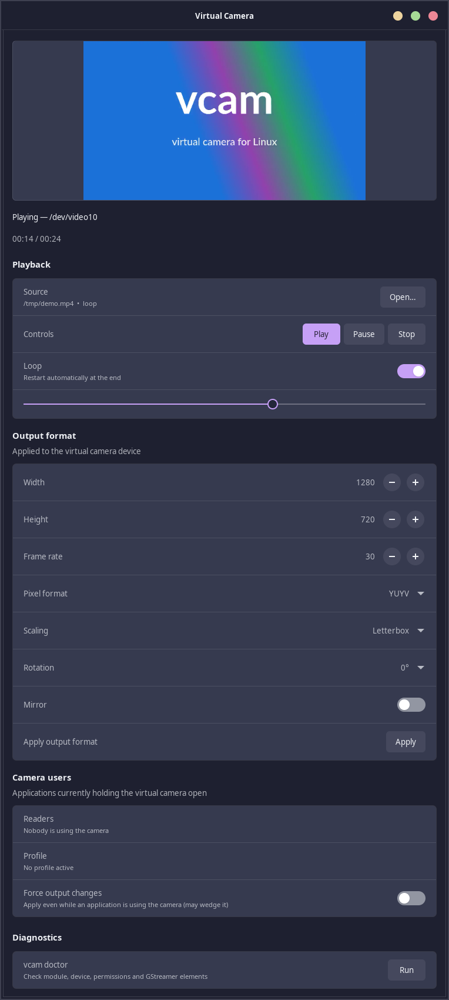
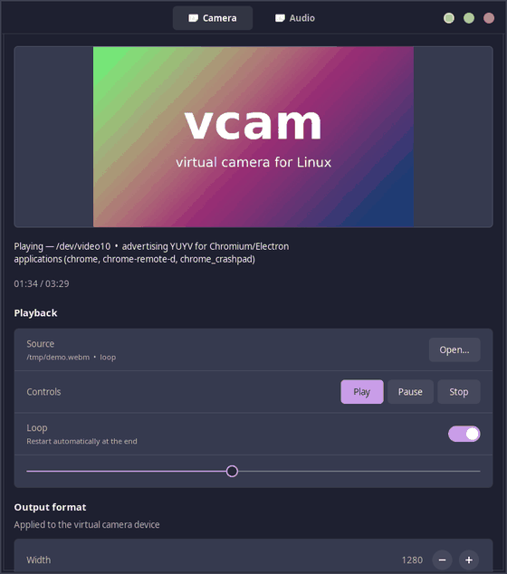
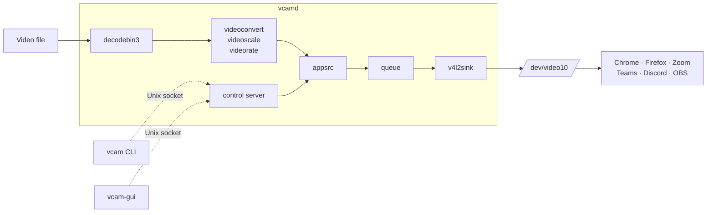

# vcam — a Linux virtual camera

[](https://github.com/ArchDityaa/vcam/actions/workflows/ci.yml)
[](https://github.com/ArchDityaa/vcam/releases/latest)
[](LICENSE)
[](https://www.rust-lang.org)
[](#requirements)

`vcam` feeds a video into a [v4l2loopback](https://github.com/umlaeute/v4l2loopback)
device so that ordinary applications — Chrome, Firefox, Zoom, Teams, Discord,
OBS, Cheese, OpenCV — see it as a normal webcam.

It is written in Rust and GStreamer. A small always-on daemon (`vcamd`) holds
the loopback device open and writes frames to it. A command line client (`vcam`)
and a GTK4 control panel (`vcam-gui`) talk to the daemon over a Unix socket, so
they never own the capture pipeline and can come and go freely.

<p align="center">
  
</p>

## Contents

- [Why vcam?](#why-vcam)
- [Features](#features)
- [Requirements](#requirements)
- [Install](#install)
- [Quick start](#quick-start)
- [Command line](#command-line)
- [GUI](#gui)
- [Configuration](#configuration)
- [How it works](#how-it-works)
- [Application compatibility](#application-compatibility)
- [Testing](#testing)
- [Roadmap](#roadmap)
- [FAQ](#faq)
- [Contributing](#contributing)
- [License](#license)

## Why vcam?

Virtual cameras are usually an afterthought of a larger application (OBS) or a
raw kernel interface with no producer. `vcam` is a dedicated, headless,
compositor-independent producer:

| | vcam | OBS Virtual Camera | v4l2loopback alone |
| --- | :---: | :---: | :---: |
| Loop a local file without a GUI app running | ✅ | ❌ (OBS must run) | ⚠️ manual pipeline |
| Works on a headless or minimal session | ✅ | ❌ | ✅ |
| Stable caps and a black placeholder while idle | ✅ | ⚠️ depends on OBS | ❌ |
| Hot-swap source, pause, resume, seek | ✅ | ⚠️ through OBS | ❌ |
| Safe output changes while apps are streaming | ✅ (deferred) | ❌ | ❌ |
| Per-application output profiles | ✅ | ❌ | ❌ |
| Watchdog with automatic recovery | ✅ | ❌ | ❌ |
| Unprivileged user daemon | ✅ | ✅ | ✅ |

## Features

- **Stable output** — the device always advertises the configured resolution and
  frame rate (default `1280x720 @ 30`, `NV12`, with `YUYV` available for
  Chromium/Electron apps).
- **Idle placeholder** — the daemon keeps the device open with a black frame, so
  applications that enumerate cameras at startup never race the producer.
- **Looping**, **hot swapping** the source, **pause / resume / seek**, and
  **error recovery** back to the placeholder.
- **Output shaping** — letterbox, fill or stretch; mirror; rotation 0/90/180/270.
- **Diagnostics** — `vcam doctor` checks the module, device, permissions and the
  required GStreamer elements.
- **Self-healing** — a watchdog rebuilds the output pipeline if it stalls or
  leaks memory, and restarts the daemon as a last resort so systemd brings it
  back cleanly.
- **Camera users** — `vcam consumers` lists the applications holding the device.
  Changing the output format while an application is streaming is deferred until
  the camera is free, which is what makes it safe to do at all.
- **Chromium/Electron compatibility** — Discord, Chrome, Brave, Slack and friends
  routinely fail to list a loopback device that only advertises `NV12`. The
  daemon watches for those applications and advertises `YUYV` while any of them
  is running, then restores the configured pixel format. `vcam compat off`
  disables the shim.
- **Access diagnosis** — when the device cannot be opened, `vcamd` and
  `vcam doctor` say *why*: no `video` group membership, a session that started
  before `usermod -aG video` (invisible to `id`, and it stops every application
  in that session from seeing the camera), or a wrong device mode. The udev rule
  carries `uaccess` so the active session user gets access without a re-login.
- **Per-application profiles** — `[[profiles]]` entries pick an output format
  automatically based on who is using the camera.
- **No root daemon** — the module is loaded at boot; the daemon runs as your
  user in the `video` group.

## Requirements

- Ubuntu 24.04 / Debian 13 (or newer), 64-bit.
- `v4l2loopback` kernel module.
- GStreamer 1.24 with base, good, bad and libav plugins.
- For the GUI: GTK 4.14 and libadwaita 1.5.
- For the `video` group access rule: your user in the `video` group.

## Install

### From a release

Download the `.deb` from the [latest release](https://github.com/ArchDityaa/vcam/releases/latest):

```sh
sudo apt install ./vcam_0.2.0_amd64.deb
sudo modprobe v4l2loopback        # or reboot, modules-load.d loads it
sudo usermod -aG video "$USER"    # then log out and back in
```

The package installs `/usr/lib/modprobe.d/v4l2loopback.conf`,
`/usr/lib/modules-load.d/v4l2loopback.conf` and the udev rule that grants the
`video` group access to `/dev/video10`. The rule also carries
`TAG+="uaccess"`, so the user of the active desktop session gets access through
systemd-logind without a re-login.

> **Logging out matters.** A group change only reaches sessions that start
> afterwards. Applications in the session that was already open when you ran
> `usermod` keep the old credentials, cannot open the device, and quietly drop
> `Virtual Camera` from their camera list. `vcam doctor` detects exactly this
> case and prints the fix.

### From source

```sh
sudo apt install build-essential pkg-config \
  libgstreamer1.0-dev libgstreamer-plugins-base1.0-dev \
  libgstreamer-plugins-bad1.0-dev libgtk-4-dev libadwaita-1-dev
git clone https://github.com/ArchDityaa/vcam.git
cd vcam
cargo build --release
sudo install -m0755 target/release/vcamd target/release/vcam target/release/vcam-gui /usr/local/bin/
```

Or build the package yourself:

```sh
packaging/build-deb.sh
sudo apt install ./target/deb/vcam_0.2.0_amd64.deb
```

## Set up the module

```sh
sudo modprobe v4l2loopback \
  video_nr=10 card_label="Virtual Camera" exclusive_caps=1 max_buffers=4
```

`exclusive_caps=1` is important: the device advertises an *output* format until
a writer starts streaming, then switches to *capture*. This is what stops
Chrome and Zoom from caching an empty capability set.

To load it at boot, copy the two files from `packaging/` into
`/etc/modprobe.d/` and `/etc/modules-load.d/`.

## Quick start

```sh
vcam doctor                       # verify the setup
vcamd &                           # or: systemctl --user start vcamd
vcam start --source movie.mp4     # start feeding the camera
```

Then pick **Virtual Camera** in any application's camera settings.

## Command line

```
vcam start [--source FILE] [--no-loop]   start playing (uses config source)
vcam stop                                stop and show the black placeholder
vcam pause | resume                      pause / resume playback
vcam seek 01:30                          seek to a position (SS, MM:SS, HH:MM:SS)
vcam source FILE                         hot swap the source while running
vcam loop on|off                         toggle looping
vcam output [--width N] [--height N] [--fps N]
            [--pixel-format NV12|YUYV]
            [--fit letterbox|fill|stretch]
            [--mirror true|false] [--rotate 0|90|180|270]
            [--force]                 apply even while apps use the camera
vcam consumers                           list applications using the camera
vcam profile list                        list configured profiles
vcam profile use NAME [--force]          apply a profile now (pins it)
vcam profile auto on|off                 toggle automatic profile selection
vcam compat on|off                       toggle the Chromium/Electron YUYV shim
vcam status                              print daemon status
vcam doctor                              run diagnostics
vcam reload                              reload the configuration file
vcam shutdown                            stop the daemon
```

All commands accept `--socket PATH` to talk to a daemon on a different socket.

## GUI

Run `vcam-gui` (or launch **Virtual Camera** from your application menu). It
shows a live preview and lets you choose a file, play/pause/stop, seek, toggle
looping, change the output format, see who is using the camera, and run the
doctor. It is an IPC client: you can use it alongside the CLI and both stay in
sync.



## Configuration

The daemon reads `~/.config/vcam/config.toml`. Write a commented default with:

```sh
vcamd --write-default-config
```

Key settings:

```toml
[device]
video_nr = 10
label = "Virtual Camera"

[output]
width = 1280
height = 720
fps = 30
pixel_format = "NV12"     # or "YUYV"
fit = "letterbox"         # letterbox | fill | stretch
mirror = false
rotate = 0

[source]
path = "/home/you/movie.mp4"
loop_video = true
autostart = false

[daemon]
log_level = "info"
auto_profiles = false     # apply matching [[profiles]] automatically

[compatibility]
# Advertise YUYV while a Chromium/Electron application (Discord, Chrome,
# Brave, Slack, ...) is running: those applications frequently fail to list a
# loopback device that only offers NV12. The configured pixel format is
# restored when they exit, and `vcam compat off` disables the shim.
chromium_yuyv = true

[watchdog]
enabled = true
max_rss_mb = 1024          # rebuild the pipeline above this memory use
stall_timeout_ms = 2000    # rebuild after this long without progress
max_push_failures = 30     # rebuild after this many failed frame pushes
max_recoveries = 5         # then exit so systemd restarts the daemon

# Optional per-application output profiles. The first entry whose `match`
# pattern matches a process holding the camera wins. Only the keys you set are
# overridden; everything else falls back to [output]. With the compatibility
# shim above on, Discord and friends already get YUYV without a profile; use a
# profile when you want more than the pixel format to change.
[[profiles]]
name = "discord"
match = ["discord", "chrome", "chromium"]
pixel_format = "YUYV"

[[profiles]]
name = "obs"
match = ["obs"]
pixel_format = "NV12"
```

> **Note** — keys such as `auto_profiles` live inside a table, which is why they
> are under `[daemon]`. Only keys written before the first `[table]` header are
> top-level.

A relative `source.path` in a config file is resolved against the directory
that contains the config file. Paths passed on the command line
(`vcam start --source movie.mp4`) are resolved against the shell's working
directory before they are sent to the daemon.

### Output changes while the camera is in use

v4l2loopback lets a single producer write the device while several applications
read it, but renegotiating its caps (resolution, frame rate, pixel format) while
an application is streaming can wedge the device. `vcam` therefore **defers**
such changes until every application has released the camera; `vcam status` and
the GUI show the pending change. Changes that do not touch the device caps
(scaling, mirroring, rotation) are applied immediately. Use `--force` to
override, accepting the risk.

Deferred changes are also how [profiles](#configuration) behave: when a matching
application starts, the profile is selected, and the format switches as soon as
the camera is free. Turning a profile on manually with `vcam profile use` pins
it and turns automatic selection off until you run `vcam profile auto on`.

## How it works



The daemon starts the output pipeline as soon as it owns the device and keeps it
running with a black placeholder. Playback attaches a decoder pipeline that
produces frames in the exact caps the output expects. The GUI never opens the
device; the daemon publishes a small preview frame that the GUI reads instead.

See [docs/architecture.md](docs/architecture.md) for the threading model, the
IPC protocol, the preview format, the consumer scan, profiles and the watchdog.

## Application compatibility

| Application | Notes |
| --- | --- |
| Chrome / Chromium | Works; the compatibility shim advertises `YUYV` for it, and the camera list may need a page reload after the daemon starts. |
| Firefox | Works. |
| Zoom | Works. |
| Microsoft Teams | Works. |
| Discord | Works. The daemon advertises `YUYV` automatically while Discord runs; the GUI no longer opens the device. |
| OBS | Add as a **Video Capture Device**; select *Virtual Camera*. |
| Cheese | Works. |
| OpenCV | `cv2.VideoCapture("/dev/video10")` or by index. |

See [docs/troubleshooting.md](docs/troubleshooting.md) if a camera does not
appear.

## Testing

```sh
cargo test --workspace           # unit tests
tests/integration.sh             # end-to-end against /dev/video10
DURATION=1800 tests/stability.sh # 30-minute 1080p30 soak test
```

The integration and stability scripts start a private daemon on a temporary
socket, so they do not disturb a `vcamd` you are already running. They do
require the module to be loaded and the device node to exist.

## Roadmap

- [x] `vcamd` daemon, CLI and GTK4 GUI
- [x] Idle placeholder, looping, hot swap, seek
- [x] Daemon-fed preview
- [x] Consumer detection and deferred output changes
- [x] Per-application profiles
- [x] Watchdog and self-healing
- [x] `.deb`, systemd, udev, man pages
- [ ] Flatpak package
- [ ] Playlist / multi-source queue
- [ ] PipeWire / portal source
- [ ] Integration tests on a self-hosted runner with `v4l2loopback`

## FAQ

**Does it work without a desktop session?**
Yes. `vcamd` only needs a user systemd session (or a plain terminal) and the
`video` group.

**Why does the preview keep working while Discord uses the camera?**
The preview is rendered by the daemon and published as a small file. A second
process cannot open the loopback device while another reader is streaming it.

**Why is my output change not applied?**
An application is still holding the camera. Run `vcam consumers`; the change is
applied automatically once they release it. `--force` applies it immediately.

**Can I use it with OBS?**
Yes, as a *Video Capture Device*. Close OBS's own virtual camera if it also
creates a loopback device, to avoid two producers.

**Is it safe to run as root?**
It is not needed. The daemon is designed to run as your user; the systemd unit
hardens it further.

## Contributing

Contributions are welcome. Read [CONTRIBUTING.md](CONTRIBUTING.md) and the
[Code of Conduct](CODE_OF_CONDUCT.md). For security issues, follow
[SECURITY.md](SECURITY.md).

## License

MIT. See [LICENSE](LICENSE).
